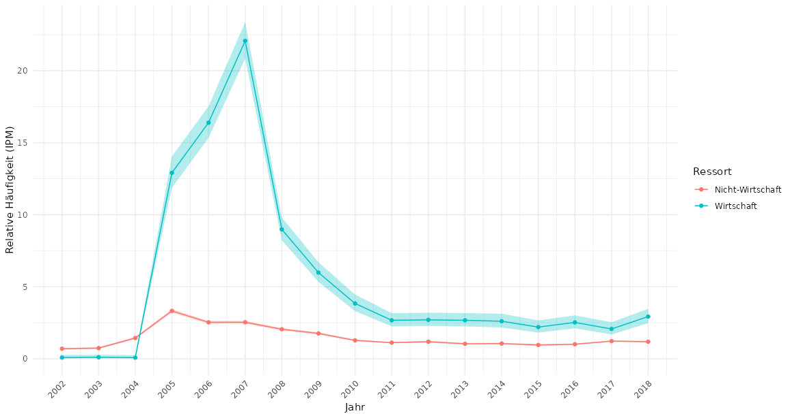
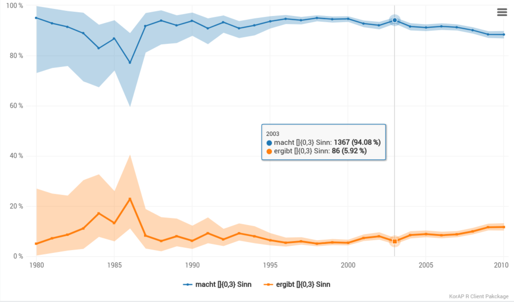

# KorAP web service client package for R <a href="https://korap.ids-mannheim.de/"></a>

[](https://cran.r-project.org/package=RKorAPClient)
[](http://www.r-pkg.org/pkg/RKorAPClient)
[](https://www.repostatus.org/#active)
[](https://www.tidyverse.org/lifecycle/#stable)
[](https://github.com/KorAP/RKorAPClient/actions)
[](https://codecov.io/gh/KorAP/RKorAPClient?branch=master)
[](https://github.com/KorAP/RKorAPClient/issues)
[](https://github.com/KorAP/RKorAPClient/issues)
[](https://github.com/KorAP/RKorAPClient/issues)
[](https://github.com/KorAP/RKorAPClient)

## Description

R client package to access the [web service API](https://github.com/KorAP/Kustvakt/wiki) of the [KorAP Corpus Analysis Platform](https://korap.ids-mannheim.de/) developed at [IDS Mannheim](http://www.ids-mannheim.de/)

## Examples

**Version note:** The dispersion analyses and new bar-chart helpers below are
planned for version 1.5.0 and require the development version until that
release is available on CRAN. They are not available in CRAN version 1.4.1.
New options such as `showCI` also require the development version.

### Hello world

```R
library(RKorAPClient)
KorAPConnection(verbose=TRUE) |> corpusQuery("Hello world") |> fetchAll()
```

### Verbose output without changing code

You can turn on verbose logging globally without changing calls by setting an environment variable (or an R option):

```r
# Environment variable (recommended for sessions / ~/.Renviron)
Sys.setenv(KORAP_VERBOSE = "true")
KorAPConnection()  # uses verbose = TRUE

# Alternatively, R option
options(rkorap.verbose = TRUE)
KorAPConnection()
```
Explicit `verbose` arguments still take precedence over these settings.

### Stopping a running search

Use RStudio's Stop button, Escape or Ctrl+C, as supported by your R interface.
The client propagates a normal R interrupt, stopping the running script rather
than returning an incomplete result or continuing to the next query. During HTTP
requests it temporarily disables the error debugger, so cancellation returns to
the console even when debugging on errors is enabled. Your error-handler setting
is restored afterwards, and ordinary request errors keep their usual handling.
With `verbose = TRUE`, cancellation adds a short "Request cancelled by user."
line to the progress output; with `verbose = FALSE`, it stays silent. This is
informational output, not an R warning, and does not change the interrupt.
Completed responses already in the local cache remain available for a later run.
Cancelling a client request does not guarantee that the server stops its work.

### Local caching of API responses

To speed up repeated analyses and to avoid unnecessary load on the KorAP servers, API responses are cached locally by default, in the cache directory that is standard for your operating system (see [R.cache](https://cran.r-project.org/package=R.cache)). Cached responses are invalidated automatically when the corpus index revision changes.

```r
kco <- KorAPConnection(cache = FALSE)  # do not cache anything in this connection
clearCache()                           # discard all locally cached responses
```

This cache is a transparent speed-up that you can throw away at any time. To keep a finished result in a file of your own instead, see the `cacheAs` parameter described further below.

Please note that, in the case of DeReKo, authorized queries behave differently inside and outside the IDS, because of the special license situation. Cached results do not record from where a request was issued, so if you get unexpected results after changing networks, use `clearCache()` or `cache = FALSE`.

### Choosing metadata fields for a time series

The client sends the virtual-corpus definition (`vc`) to the selected KorAP instance. Available metadata fields, their meaning and their coverage depend on that corpus; the client cannot decide which field answers your research question.

- `pubDate` refers to publication, whereas `creationDate` refers to text creation. They are not generally interchangeable. For a question about publication years, use `pubDate`; for creation years, use `creationDate`, after checking how the corpus defines and populates the field.
- A publication date may describe the edition represented in the corpus, rather than the first publication of the work. A creation date is not automatically a documented date of first publication either.
- The two fields may give the same results in one corpus or subset. Do not assume that this carries over to another corpus, particularly when moving between DeLiKo and DeReKo.

Check the corpus documentation for the intended meaning, missing values and date precision. `textMetadata()` (see below) shows stored values for individual texts; it does not supply field definitions or a complete inventory of possible values. A syntactically valid query and plausible counts do not establish that the right metadata field was chosen. The need for accessible field descriptions is also discussed in [Kalamar issue #40](https://github.com/KorAP/Kalamar/issues/40).

The following time-series examples use `creationDate`; their year axis therefore follows that field, not necessarily publication year.

### Frequencies over time and newspaper sections using ggplot2

```r
library(RKorAPClient)
library(ggplot2)
kco <- KorAPConnection(verbose = TRUE)

expand_grid(
  ressort = c(
    Wirtschaft = "idsColumn = /Wirtschaft.*/",
    `Nicht-Wirtschaft` = "idsColumn != /Wirtschaft.*/"
  ),
  year = 2002:2018
) |>
  mutate(
    frequencyQuery(kco, "[tt/l=Heuschrecke]",
      paste(ressort, "& creationDate in", year)),
    ressort = names(ressort)
  ) |>
  ipm() |>
  ggplot(aes(year, ipm, fill = ressort, colour = ressort)) +
  theme_minimal() +
  geom_freq_by_year_ci() +
  labs(x = "Jahr", y = "Relative Häufigkeit (IPM)",
       fill = "Ressort", colour = "Ressort")
```
<!-- -->

`frequencyQuery` returns a data frame with raw frequencies (in `totalResults`), relative frequencies (in `f`), and confidence intervals. The relative frequencies and confidence limits are proportions, not values per million. Use `ipm()` when a plotting workflow needs values per million, as in the ggplot2 example above. When using `hc_freq_by_year_ci()`, pass the `frequencyQuery()` result directly: that helper performs the conversion itself (or converts to percentages with `as.alternatives = TRUE`). Calling `ipm()` first would scale the confidence limits twice.

### Dispersion across metadata

Available from version 1.5.0 (currently the development version).

[](https://lifecycle.r-lib.org/articles/stages.html#experimental)

`dispersionAnalysis()` is experimental: its interface and result structure may
change in future releases.

Research question: **Are Nutzer*innen and Nutzer:innen similarly dispersed
across press sources, publication countries and publication years in 2023-2025,
accounting for the token counts in each group?**
Search both variants, fetch their metadata, then compare their dispersion:

```r
kco <- KorAPConnection()
queries <- c("Nutzer*innen" = "[orth='Nutzer*innen']",
             "Nutzer:innen" = "[orth='Nutzer:innen']")
hits <- corpusQuery(kco, queries,
  vc = "pubDate since 2023 & pubDate until 2025 & textType=/Zeit.*/ & pubPlaceKey=/.+/",
  fields = c("corpusTitle", "pubPlaceKey", "pubDate")) |>
  fetchSamplePages(maxHits = Inf, seed = 7)
d <- dispersionAnalysis(hits, by = c("source", "pubPlaceKey", "year"))
d  # measures as rows; one column per spelling
hc_dispersion(d, partition = "source", top = 12)
hc_dispersion(d, partition = "pubPlaceKey")
```

`hc_dispersion()` plots the stored distributions without another query. Coloured
bars show each variant's share of hits; grey bars show the corresponding share
of corpus tokens. Each series uses hits or tokens within the listed parts as
its denominator. The helper works with any partition in a query-based dispersion
result, including custom partitions and more than two query variants. Choose
one partition and a common virtual corpus per chart.

For large partitions, `top` retains the parts with the largest hit shares across
any variant and combines the rest into a labelled remainder. All shares still
use the complete listed population; dispersion scores are unchanged. `top = Inf`
shows every part. Tooltips distinguish shares of total frequency from relative
frequencies per million tokens and report absolute frequencies and subcorpus sizes;
click an individual variant bar for its concordance. The corpus reference and
combined remainder have no concordance link. Estimates and zero-hit variants
are explicitly identified. The six dispersion scores remain in the table,
since their scales and directions differ. See the [Highcharts license notes](#highcharts).

Calendar-year partitions show all years in chronological order by default;
an explicit `top` can still limit them. The Highcharts helpers share theme
handling and concordance-click behavior. Bar charts use the package palette;
year plots retain their historical D3 palette. Explicit themes take priority.
Use `highcharter::hc_colors()`
and `highcharter::hc_tooltip()` to customize the resulting chart; the grey
corpus-token reference in `hc_dispersion()` retains its neutral colour.

Themes from `idsThemeR` work through the normal highcharter interface:

```r
hc_dispersion(d, partition = "pubPlaceKey") |>
  highcharter::hc_add_theme(idsThemeR::hc_theme_ids_dark())
# Or set options(highcharter.theme = idsThemeR::hc_theme_ids_light())
# before constructing charts; all three interactive helpers respect it.
```

Generated chart text and numbers automatically follow the browser's German or
English language preferences (English is the fallback). Query names and custom
labels stay as supplied. For reproducible exports, set
`options(rkorap.chart.language = "de")` or `"en"`; the default `"auto"` uses
the browser. Relative frequencies use **IPM** (instances per million tokens).
Confidence intervals and bands use subdued neutral greys by default, keeping
the observed frequencies visually prominent. Themes and explicit colour settings
can override these defaults.

`maxHits = Inf` fetches all hits, so this comparison uses exact distributions.
For exploratory page-sample estimates, replace the fetch step with
`fetchSamplePages(maxHits = 2000, seed = 7)`. Clustering within pages can strongly
bias dispersion scores, even when extrapolated hit counts are unbiased. The
printout shows hits used, pages used/available and inclusion probabilities for
each variant when any scores are estimated. Different inclusion probabilities
trigger a warning; use complete data or exact part counts for comparisons.

The country-presence filter `pubPlaceKey=/.+/` is a temporary workaround for
missing location metadata in HAZ23-HAZ25. All three analyses therefore use
texts with a publication-country key. Remove this filter once the metadata
have been repaired.

The library discovers the sources and their token sizes, including sources
without hits. No source lists, corpus-size calculations or classification
functions are needed in the analysis script. `by = "source"` groups annual
DeReKo corpus titles into sources automatically. To specify the metadata field
and suffix rule explicitly, use:

```r
dispersionAnalysis(hits, by = "corpusTitle", regex = " [0-9]{4}$")
```

Here `regex` removes the matching suffix; it does not select which sources to
include. Other metadata fields work without a regex. `by = "year"` groups
publication dates into years, and `by = "region"` uses `pubPlaceKey`. A vector
such as the one above reuses the same hit sample for all three dimensions.

Years are discrete calendar-year groups, with the token count of each year as
its size. Years containing corpus texts but no query hits remain included.
These measures ignore year order and time gaps: they describe evenness across
years, rather than an increasing or decreasing trend. A trend test would be a
separate analysis. Compare the spellings within each dimension; source, country
and year scores describe different partitions.

`fetchSamplePages()` selects complete pages without replacement, up to `maxHits`
hits per query. It warns that hits within pages retain Lucene index order:
these are page samples, not independent random hits. If all results fit within
`maxHits`, they are fetched completely. The seed, selected pages and inclusion
probability are recorded. `dispersionAnalysis()` reuses those exact pages; missing
metadata are added for the same pages without drawing again. `fetchAll()` is
the explicit alternative for complete results.

Without an explicit fetch, `dispersionAnalysis()` requests exact counts per metadata
group. With an explicit fetch, it reuses the recorded pages or complete,
unjoined metadata containing all requested fields. `exactFrequencies = TRUE`
requests exact part counts even after a sample; `exactFrequencies = FALSE`
explicitly permits implicit page sampling, controlled by `searchHitsSampleLimit`
and `seed`. Metadata whose
multiple values were joined by a default `fetchAll()` are not reused for
automatic grouping; use `fetchAll(preserveMetadataValues = TRUE)` to retain
them. Multiple queries share the same complete source basis, including
zero-hit sources for each variant.

Preserved metadata with at most one value per hit remain ordinary vectors;
missing values are `NA`. Only genuinely multivalued columns remain lists.
Subsequent `fetchNext()` and `fetchRest()` calls inherit the recorded fetch
mode. To change modes, restart with `fetchAll(preserveMetadataValues = ...)`.

The first call also discovers metadata groups independently of the hits, so
that zero-hit sources are retained. This uses representative metadata records,
not a corpus download. Known groups from all fetched variants seed the shared
discovery. Discovery and size requests can take time, especially
for metadata with many categories; the complete partition is cached per
server, index revision, virtual corpus and grouping rule.

The defaults are DP, DPnorm, Juilland's D, Carroll's D2, Rosengren's S and range.
Smaller DP/DPnorm and larger D/D2/S indicate more even distributions, but the
measures need not give the same ranking. Their suitability depends on the
research question; none distinguishes productive usage from quotation or
establishes social acceptance. The result prints the measures without hiding
them behind technical columns. Detailed counts remain in `d$distribution`,
and sampling information remains in `d$sampling`.

#### Interpreting the measures

Start with the research question: **reach across sources** and **evenness after
allowing for source sizes** are different properties. A more frequent variant
can reach more sources while still being concentrated in a few of them.

| Measure | What it describes | How to read it |
|---|---|---|
| range | Number of corpus parts with at least one hit | Larger means broader observed reach. It does not account for part sizes or how many hits each part contains, and depends on the total hit count. |
| DP | Difference between each part's share of hits and its share of corpus tokens | Smaller means closer to the corpus's token distribution; 0 is an exact match. |
| DPnorm | DP rescaled by its maximum for the given part sizes | Smaller means closer; 0 is an exact match and 1 is maximum concentration under this normalization. |
| Juilland's D | Variation in the hit frequencies per token across parts | Larger means more even; 1 means the same relative frequency in every part. |
| Carroll's D2 | Entropy of the relative frequencies across parts | Larger means more even; 1 means the same relative frequency in every part. |
| Rosengren's S | Similarity between the distribution of hits and corpus tokens | Larger means closer; 1 is an exact match. |

DP has a concrete interpretation: **DP = 0.20 means that 20% of the hit
distribution would have to be reallocated between parts to match their shares
of corpus tokens**, keeping the total number of hits fixed. This is a
hypothetical redistribution of hit mass, allowing fractional counts; it is not
the percentage of sources using a spelling or of people accepting it. This
interpretation applies to DP, not directly to its rescaled value DPnorm.

Compare variants within the same virtual corpus and partition. Source, country
and year partitions answer different questions; their scores are not on a
common substantive scale. There is no universal cutoff for "well dispersed",
and these descriptive scores are not a significance test. Disagreement between
measures should be reported rather than resolved by counting wins or averaging
ranks: the result would depend on the chosen measures, closely related measures
would receive repeated votes, and ranks discard the size of differences.

Use the counts and token sizes in `d$distribution` to examine which sources
drive the result. The share of hits in the largest one or two sources is an
intuitive companion description; compare it with those sources' token shares.
A variant can be less dominated by its largest source but more dominated by its
largest two. The scores alone do not distinguish house style, quotation,
syndicated material or discussion of the spelling itself. Such explanations
require inspecting the concordances. With sampled results, also check coverage
in `d$sampling`; page clustering can strongly bias the scores.

The measures are implemented independently from the published formulas, using
the unequal-part-size versions described in
[Gries (2020), *Analyzing dispersion*](https://doi.org/10.1007/978-3-030-46216-1_5).
See also [Gries' companion resources](https://www.stgries.info/research/dispersion/links.html).
His script is neither bundled nor loaded. The underlying references are:

- DP: [Gries (2008), *Dispersions and adjusted frequencies in corpora*](https://doi.org/10.1075/ijcl.13.4.02gri), International Journal of Corpus Linguistics, 13(4), 403–437.
- DPnorm correction: [Lijffijt & Gries (2012)](https://doi.org/10.1075/ijcl.17.1.08lij), International Journal of Corpus Linguistics, 17(1), 147–149.
- D: Juilland & Chang-Rodríguez (1964), *Frequency dictionary of Spanish words*. Mouton.
- D2: Carroll (1970), *An alternative to Juilland's usage coefficient for lexical frequencies, and a proposal for a standard frequency index (SFI)*, Computer Studies in the Humanities and Verbal Behavior, 3(2), 61–65.
- S: Rosengren (1971), *The quantitative concept of language and its relation to the structure of frequency dictionaries*, Études de linguistique appliquée (Nouvelle Série), 1, 103–127.

The functions are replaceable, just as with collocation scores:

```r
myMeasures <- list(
  DP = dispersionDP,
  evenness = function(frequencies, sizes) 1 - dispersionDP(frequencies, sizes)
)
dispersionAnalysis(hits, by = "source", scoreFunctions = myMeasures)
```

`dispersionAnalysis(frequencies, sizes, scoreFunctions = myMeasures)` also works locally
on your own counts. `dispersionQuery(kco, query, by = "source", vc = ...)` is a
convenience wrapper around the query-result workflow. For custom partitions,
`corpusPartition()` and its named `parts`/`classify` interface remain available.
`frequencyQuery(dispersionBy = ...)` can attach dispersion analyses to frequency
results. `cacheAs` keeps results for reproducibility.

Samples contain pages rather than independent hits. Sample-based measures can
be strongly biased by page clustering; range is only a lower bound on occupied parts.
No dispersion confidence interval is implied. Run `demo("dispersion")` for the
research question and a short complete two-variant comparison.

### Interactive time-series plots using [highcharter](http://jkunst.com/highcharter/)

For an **interactive frequency plot over time with confidence intervals**, pass the result of `frequencyQuery()` directly to `hc_freq_by_year_ci()`. This helper is provided by RKorAPClient and returns an interactive HTML widget, with tooltips and clickable data points that open the corresponding KorAP search results. No additional plotting package needs to be loaded. By default, it shows frequencies per million tokens; the example below uses `as.alternatives = TRUE` to show percentages instead.

See the [Highcharts license notes](#highcharts) below.

```r
library(RKorAPClient)
query = c("macht []{0,3} Sinn", "ergibt []{0,3} Sinn")
years = c(1980:2010)
as.alternatives = TRUE
vc = "textType = /Zeit.*/ & creationDate in"
KorAPConnection(verbose = TRUE) |>
  frequencyQuery(query, paste(vc, years), as.alternatives = as.alternatives) |>
  hc_freq_by_year_ci(as.alternatives)
```

[<!-- -->](https://korap.github.io/RKorAPClient/man/figures/Readme-Example-2.html)

### Interactive frequency comparisons with confidence intervals

Available from version 1.5.0 (currently the development version).

For an **interactive bar chart comparing frequencies between corpora or queries**,
pass the unconverted `frequencyQuery()` result to `hc_freq_bar_ci()`. Like
`hc_freq_by_year_ci()`, this helper converts frequencies and confidence limits
to instances per million tokens automatically. Do not call `ipm()` or `percent()`
first. No additional plotting package needs to be loaded, and plotting stored
results makes no further requests to KorAP. Click a bar to open its concordances.

```r
library(RKorAPClient)
kco <- KorAPConnection("https://korap.dnb.de")
frequencyQuery(kco, "Berlin",
  vc = c(Buchpreis = "award=buchpreis", DeLiKo = "")) |>
  hc_freq_bar_ci()
```

Named virtual corpora supply the category labels. A single query is compared
across corpora; multiple queries in one corpus are compared across queries:

```r
frequencyQuery(kco, c("Iowa", "Berlin"), vc = "award=buchpreis") |>
  hc_freq_bar_ci(horizontal = FALSE)
```

With multiple queries and multiple corpora, the chart groups queries within
each corpus. Set `expand = TRUE` in `frequencyQuery()` to request every
query/corpus combination, including when the two vectors have equal lengths.
Missing combinations and undefined frequencies remain gaps, while a zero-hit
query in a non-empty corpus retains its confidence interval. Supplied
confidence limits are preserved, including a custom `conf.level`.

For percentages of mutually exclusive, exhaustive alternatives, set
`as.alternatives = TRUE` in `frequencyQuery()`. The Highcharts helpers inherit
this recorded mode and reject a conflicting plotting argument. They retain
the original denominators when only some result rows are displayed. For older
tables without the recorded mode, specify it in the plotting call as well.
Use `hc_freq_bar_ci(log = TRUE)` for a logarithmic axis: zero frequencies and
intervals touching zero cannot be represented and are explicitly omitted.
Use `highcharter` functions to customize the returned widget.
Run `demo("writtenVsSpoken_highcharts")` for the spoken/written comparison.

Use `showCI = FALSE` to omit confidence intervals from frequency plots and
their tooltips. The option is available in `hc_freq_bar_ci()`,
`hc_freq_by_year_ci()`, `geom_freq_bar_ci()` and `geom_freq_by_year_ci()`;
its default is `TRUE`. Observed frequencies are retained, and confidence-limit
columns are not required when intervals are disabled.

### Frequency bar charts for print using ggplot2

For a static figure suitable for print, use `geom_freq_bar_ci()`, the bar-chart
counterpart of `geom_freq_by_year_ci()`. It combines columns and aligned error
bars in a normal ggplot. **Convert the frequencies and confidence limits with
`ipm()` once before plotting**; this ggplot layer does not perform the automatic
conversion used by `hc_freq_bar_ci()`.

```r
library(RKorAPClient)
library(ggplot2)

p <- KorAPConnection("https://korap.dnb.de") |>
  frequencyQuery("Berlin",
    vc = c(Buchpreis = "award=buchpreis", DeLiKo = "")) |>
  ipm() |>
  ggplot(aes(x = label, y = ipm)) +
  geom_freq_bar_ci() +
  labs(x = NULL, y = "Instances per million tokens") +
  theme_bw()

p
ggsave("berlin.pdf", plot = p, width = 6, height = 4)
```

Map `fill` and `group` to the query variable for grouped comparisons. Bars and
intervals use the same dodge width. Explicit groups retain their positions
when colours or fills are overridden for monochrome printing. Use
`coord_flip()` for horizontal bars, or map `aes(x = ipm, y = label)` with
`geom_freq_bar_ci(orientation = "y")`. Ordinary ggplot themes, scales, facets
and exports work as usual. For alternatives, use `as.alternatives = TRUE` in
`frequencyQuery()` and `percent()` instead of `ipm()` before plotting.
The layer preserves supplied confidence limits and does not query KorAP.
Add `idsThemeR::theme_ids()` and `idsThemeR::scale_fill_ids()` for IDS styling;
mapped colours can use `idsThemeR::scale_colour_ids()`.

### Use other corpora than DeReKo as basis

Set the first (`KorAPUrl`) argument of the `KorAPConnection` function to the URL of the KorAP instance, providing the desired corpus, e.g. to 

* `https://korap.ids-mannheim.de/instance/wiki/` for the current German Wikipedia corpus provided by the IDS
* `https://korap.ids-mannheim.de/instance/english/` for an English Wikipedia corpus provided by the IDS
* `https://korap.dnb.de/` for the DeLiKo@DNB-XL German fiction corpus
* `https://korap.racai.ro/` for the Contemporary Corpus of the Romanian Language (CoRoLa)

```r
library(RKorAPClient)
KorAPConnection(KorAPUrl = "https://korap.ids-mannheim.de/instance/wiki/", verbose = TRUE) |>
  corpusQuery("Berlin") |>
  fetchAll()
```
  
### How big is my (virtual) corpus?

`corpusStats` reports the size of the whole corpus or of a virtual corpus:

```r
library(RKorAPClient)
kco <- KorAPConnection(verbose = TRUE)
corpusStats(kco, vc = "pubDate since 2020")
```

```
<KorAPCorpusStats>
The virtual corpus described by "pubDate since 2020" contains 3,942,948,561 tokens
in 253,752,552 sentences in 13,857,981 documents.
```

Passing a *named* vector of virtual corpora returns one row per corpus, labelled by the names you chose for them in a `label` column. `frequencyQuery` and `collocationScoreQuery` label their results the same way:

```r
corpusStats(kco, vc = c(before = "pubDate until 2009", since = "pubDate since 2010"), as.df = TRUE)
```

With `as.df = TRUE` you get a one row data frame with `tokens`, `sentences`, `paragraphs` and `documents` columns instead, which makes it easy to compare several virtual corpora.

### Regular expressions in queries and virtual corpora

The query language (Poliqarp+) and the definitions of virtual corpora mark regular expressions differently, and double quotes mean opposite things in them:

|                    | query (Poliqarp+)                    | virtual corpus (`vc`)                  |
|--------------------|--------------------------------------|----------------------------------------|
| regular expression | `"…"`, e.g. `[tt/l="(Frau\|Mann)"]`  | `/…/`, e.g. `textType = /.*Krimi.*/`   |
| literal string     | `'…'`                                | `"…"`                                  |

```r
KorAPConnection("https://korap.dnb.de") |>
  frequencyQuery('[tt/l="(Frau|Mann)"]', vc = "textType = /.*Krimi.*/")
```

In a query, `/` separates foundry and layer, as in `tt/l`, and is no regex delimiter. In a `vc`, `textType = "Krimi.*"` is no error, but looks for the literal string and finds nothing. Both follow the [regular expression syntax of Lucene 5](https://lucene.apache.org/core/5_0_0/core/org/apache/lucene/util/automaton/RegExp.html), not the Perl-style one of most programming languages. A regular expression has to match the whole value, hence the `.*` around *Krimi*. Inline flags, like `(?i)` for ignoring case, are not supported, so spell out case variants, e.g. `[Kk]rimi`. Nor are shorthand classes: `\d` stands for just the letter *d*, so write `[0-9]` instead.

### Slow queries: use a random sample of texts

Complex queries can take minutes on a large corpus, especially on DeLiKo@DNB (`https://korap.dnb.de`), or exceed the time limit of the server, in which case RKorAPClient warns that the results are incomplete. As long as KorAP does not offer sampling by itself, you can work around this, if relative frequencies are what you are after, by restricting the virtual corpus to a pseudo-random sample of texts, selected by the last digit of their text sigle (e.g. `A00/JUN/39609`):

| `vc`                    | sample of texts |
|-------------------------|-----------------|
| `textSigle = /.*5/`     | about 10 %      |
| `textSigle = /.*[0-4]/` | about 50 %      |

```r
KorAPConnection("https://korap.dnb.de", verbose = TRUE) |>
  frequencyQuery("[orth=mit] [orth=einer]", vc = "textSigle = /.*5/")
```

The relative frequency `f` remains an estimate for the whole (virtual) corpus, with a correspondingly wider confidence interval, whereas `totalResults` counts only the hits in the sample. Combine the sample with other conditions using `&`, e.g. `vc = "textType = /.*Krimi.*/ & textSigle = /.*5/"`. Each digit selects a different sample, and always the same one, so results stay reproducible.

How much time a sample saves depends on whether the server has recently read the index of the query terms, for whatever query. If not, it saves hardly any, because most of the time goes into reading the index from disk: in DeLiKo@DNB, the query above took 35 seconds on the 10 % sample, about as long as a comparable query on the whole corpus. If so, it saves about as much as it leaves out: the same query took 0.9 seconds on another 10 % sample and 6.6 seconds on the whole corpus. A sample therefore pays off in series of queries on the same terms, such as a `frequencyQuery` over many years or a `collocationAnalysis`. Repeating a query on the same `vc` takes no time anyway, as its result comes from the [local cache](#local-caching-of-api-responses). Queries that are fast anyway do not get faster, because selecting the sample takes some time itself.

### Metadata of a text

`textMetadata` retrieves all metadata KorAP holds for a text, given its sigle as found in the `textSigle` column of query results:

```r
KorAPConnection() |> textMetadata("WPD17/L79/98721")
```

|textSigle       |author                 |title    |pubDate    |textType     |
|:---------------|:----------------------|:--------|:----------|:------------|
|WPD17/L79/98721 |GeorgDerReisende, u.a. |Leverone |2017-07-01 |Enzyklopädie |

The result has one column per metadata field the corpus provides – 26 in this example, so the table above shows only a selection.

### Association scores for collocation candidates you already have

While `collocationAnalysis` searches for collocates, `collocationScoreQuery` computes association scores for pairs you already have in mind. It accepts a vector of collocates and queries every combination of collocate and virtual corpus:

```r
KorAPConnection() |>
  collocationScoreQuery("Grund", c("triftiger", "guter", "Berlin"))
```

|node  |collocate |        O|         E| logDice|   pmi|       ll|
|:-----|:---------|--------:|---------:|-------:|-----:|--------:|
|Grund |triftiger |  2390.50|      6.31|    3.96|  8.57| 23808.61|
|Grund |guter     | 12902.50|   2713.24|    6.06|  2.25| 19868.49|
|Grund |Berlin    |  7865.50|  26212.26|    3.84| -1.74| 17766.78|

`O` is the observed and `E` the expected co-occurrence frequency. *Triftiger* is by far the most strongly attracted of the three (highest `pmi`), while *Berlin* co-occurs with *Grund* less often than chance would predict, which is what a negative `pmi` expresses. `logDice`, in contrast, does not compare against an expected frequency but relates the co-occurrence frequency to how often the two words occur at all, which is why the frequent *guter Grund* leads there – and why *Berlin*, although it co-occurs with *Grund* less often than expected, still scores nearly as high as *triftiger*. `collocationAnalysis` therefore discards collocates occurring less often than expected by default, which its `minObservedExpectedRatio` parameter controls. `collocationScoreQuery` does not filter, since here the pairs to score are asked for explicitly – which is why *Berlin* is shown above.

### Identify *in … setzen* light verb constructions using `collocationAnalysis`

```r
library(RKorAPClient)
library(knitr)
KorAPConnection(verbose = TRUE) |> auth() |>
  collocationAnalysis(
    "focus(in [tt/p=NN] {[tt/l=setzen]})",
    leftContextSize = 1,
    rightContextSize = 0,
    exactFrequencies = FALSE,
    searchHitsSampleLimit = 1000,
    topCollocatesLimit = 20
  ) |>
  mutate(LVC = sprintf("[in %s setzen](%s)", collocate, webUIRequestUrl)) |>
  select(LVC, logDice, pmi, ll) |>
  head(10) |>
  kable(format="pipe", digits=2)
```

The focus, here, with the `[tt/l=setzen]` in braces, makes sure that the left context size parameter 1 is understood relative to the lemma `setzen`. 
The `[tt/p=NN]` in the focus query makes sure that only nouns (at this position) are considered as collocates.
To perform a simple collocation analysis for a word form, rather than a lemma and without restriction to light verb constructions, simply use, for instance, `KorAPConnection(verbose = TRUE) |> auth() |> collocationAnalysis("setzte")`.
For a lemma, either put the lemma layer into the query itself, `collocationAnalysis("[tt/l=setzen]")`, or let `lemmatizeNodeQuery = TRUE` build that query from the word form: `collocationAnalysis("setzen", lemmatizeNodeQuery = TRUE)`.


|LVC                                                                                                                                                                  | logDice|   pmi|        ll|
|:--------------------------------------------------------------------------------------------------------------------------------------------------------------------|-------:|-----:|---------:|
|[in Szene setzen](https://korap.ids-mannheim.de/?q=Szene%20focus%28in%20%5btt%2fp%3dNN%5d%20%7b%5btt%2fl%3dsetzen%5d%7d%29&ql=poliqarp)                              |    9.66| 10.86| 465467.52|
|[in Gang setzen](https://korap.ids-mannheim.de/?q=Gang%20focus%28in%20%5btt%2fp%3dNN%5d%20%7b%5btt%2fl%3dsetzen%5d%7d%29&ql=poliqarp)                                |    9.21| 10.57| 256146.92|
|[in Verbindung setzen](https://korap.ids-mannheim.de/?q=Verbindung%20focus%28in%20%5btt%2fp%3dNN%5d%20%7b%5btt%2fl%3dsetzen%5d%7d%29&ql=poliqarp)                    |    8.46|  9.62| 189682.19|
|[in Kenntnis setzen](https://korap.ids-mannheim.de/?q=Kenntnis%20focus%28in%20%5btt%2fp%3dNN%5d%20%7b%5btt%2fl%3dsetzen%5d%7d%29&ql=poliqarp)                        |    8.28|  9.81| 101112.02|
|[in Bewegung setzen](https://korap.ids-mannheim.de/?q=Bewegung%20focus%28in%20%5btt%2fp%3dNN%5d%20%7b%5btt%2fl%3dsetzen%5d%7d%29&ql=poliqarp)                        |    8.11|  9.24| 149397.91|
|[in Brand setzen](https://korap.ids-mannheim.de/?q=Brand%20focus%28in%20%5btt%2fp%3dNN%5d%20%7b%5btt%2fl%3dsetzen%5d%7d%29&ql=poliqarp)                              |    8.10|  9.33| 122427.05|
|[in Anführungszeichen setzen](https://korap.ids-mannheim.de/?q=Anf%c3%bchrungszeichen%20focus%28in%20%5btt%2fp%3dNN%5d%20%7b%5btt%2fl%3dsetzen%5d%7d%29&ql=poliqarp) |    7.50| 11.96|  33959.99|
|[in Kraft setzen](https://korap.ids-mannheim.de/?q=Kraft%20focus%28in%20%5btt%2fp%3dNN%5d%20%7b%5btt%2fl%3dsetzen%5d%7d%29&ql=poliqarp)                              |    6.88|  7.88|  77796.85|
|[in Marsch setzen](https://korap.ids-mannheim.de/?q=Marsch%20focus%28in%20%5btt%2fp%3dNN%5d%20%7b%5btt%2fl%3dsetzen%5d%7d%29&ql=poliqarp)                            |    6.87|  9.27|  22041.63|
|[in Klammern setzen](https://korap.ids-mannheim.de/?q=Klammern%20focus%28in%20%5btt%2fp%3dNN%5d%20%7b%5btt%2fl%3dsetzen%5d%7d%29&ql=poliqarp)                        |    6.55| 10.08|  15643.27|

Collocation analyses can take a while, and comparing them across virtual corpora, as shown below, multiplies that. With the `cacheAs` parameter you can have the result stored in an RDS file of your choice, so that repeated calls – when re-knitting a document, for example – return the cached result immediately instead of querying the server again:

```r
KorAPConnection(verbose = TRUE) |> auth() |>
  collocationAnalysis("Ameisenplage", cacheAs = "ameisenplage-ca.rds")
```

`frequencyQuery`, `corpusStats`, `collocationScoreQuery` and `textMetadata` take the parameter as well, where it is less about time: the file keeps the numbers a text was written about, which KorAP would answer differently once the corpus has grown, and it lets the script run again without a server at all. A file is only reused for the call that produced it – a changed parameter, a different KorAP instance, or a version of RKorAPClient whose scores differ has it recomputed and overwritten, with a warning saying why.

Consider keeping such a file under version control next to the document that uses it, so that the analysis travels with the text. `cacheAsInfo()` reads back what produced it: parameters, KorAP instance, index revision and package version.

When a file is refused although you know it to be sound – one written by a development version that already had the current scores, say – `blessCacheAs("klima.rds")` vouches for it once and for good. And when there is no time to recompute anything at all, `withCachedResults({ ... })` takes the files as they are for the code inside it, with `mode = "offline"` refusing to query the server even for a file that is missing:

```r
withCachedResults(mode = "offline", {
  ca <- kco |> collocationAnalysis("Klima", cacheAs = "klima-ca.rds")
})
```

### Comparing collocates across virtual corpora (experimental)

If you pass a *named* vector of virtual corpora as `vc`, `collocationAnalysis` compares the collocates of the node between them and adds a set of comparison columns, labelled with the names you provided:

```r
library(RKorAPClient)
library(dplyr)

ca <- KorAPConnection(verbose = TRUE) |> auth() |>
  collocationAnalysis(
    "Klima",
    vc = c(Nullerjahre = "creationDate since 2000 & creationDate until 2009",
           Zehnerjahre = "creationDate since 2010 & creationDate until 2019"),
    leftContextSize = 1,
    rightContextSize = 1,
    exactFrequencies = FALSE,
    searchHitsSampleLimit = 2000,
    topCollocatesLimit = 20
  )

ca |>
  filter(label == "Zehnerjahre", !imputed) |>
  arrange(desc(delta_logDice)) |>
  select(collocate, logDice_Nullerjahre, logDice_Zehnerjahre, delta_logDice, winner_logDice)
```

Besides the usual association scores, the result then contains, for each score:

* `<score>_<label>` – the score of the collocate in the respective virtual corpus,
* `delta_<score>` and `max_delta_<score>` – the difference between the compared corpora,
* `winner_<score>` / `loser_<score>` – the label in which the collocate is most / least characteristic, each with a corresponding `_value` and `_webUIRequestUrl` column that links directly to the concordances in the KorAP web interface,
* `imputed`, `n_imputed` and `imputed_<label>` – markers for collocates that were attested in one of the compared corpora only.

Two properties are worth knowing when working with these columns:

* The result holds **one row per collocate and virtual corpus**, with the comparison columns repeated identically on each of them. Filter on `label`, as above, to get one row per collocate.
* Collocates that pass the `minOccur` and `topCollocatesLimit` thresholds in one virtual corpus but not in the other have no observed score for the latter. Such cells are imputed from a floor value, so their `delta_*` measures the distance to that floor rather than an attested difference. `filter(!imputed)` restricts the comparison to collocates attested everywhere, and `queryMissingScores = TRUE` retrieves the missing scores from the server instead.

Since the labels become part of the column names, plain syntactic names work best – a label starting with a digit, for instance, ends up prefixed with `X`. The names and semantics of the comparison columns are still experimental and may change without a deprecation cycle; `?collocationAnalysis` documents them in full, including how to read them.

### <a name="authorization"></a> Authorizing RKorAPClient applications to access restricted KWICs from copyrighted texts

In order to perform collocation analysis and other textual queries on corpus parts for which KWIC access requires a login, you need to authorize your application with an access token.

What a token buys is KWIC access, not the query itself. Frequencies are counted over the whole corpus either way, so `frequencyQuery()`, `corpusStats()` and `collocationScoreQuery()` need no authorization even on DeReKo – the very first example above queries it unauthorized. What an unauthorized application does not receive are the KWIC snippets of copyrighted texts, which is why `corpusQuery()` with `metadataOnly = FALSE` and `collocationAnalysis()`, which reads those snippets, do need one there.

Even that is a matter of the individual text's license rather than of the corpus: DeReKo's freely licensed parts, the Wikipedia corpora among them, hand out their snippets to anyone. Some instances are liberally licensed throughout and need no authorization at all – the German and English Wikipedia talk pages at <https://korap.ids-mannheim.de/instance/wiki> and <https://korap.ids-mannheim.de/instance/english>, both under a Creative Commons license, return KWIC snippets to a plain `KorAPConnection()`.

In the case of DeReKo, authorization can be done in three different ways.

#### 1. The latest and laziest way (available since RKorAPClient 1.0.0)

Authorize your RKorAPClient application via the usual OAuth browser flow *using the default application id* and the `auth` method:

```R
kco <- KorAPConnection() |> auth()
```

#### 2. The old way: Authorize your RKorAPClient application manually
(Required for headless operation, e.g. in batch scripts)

1. Log in into the [KorAP DeReKo instance](https://korap.ids-mannheim.de/)
1. Open the [KorAP OAuth settings](https://korap.ids-mannheim.de/settings/oauth#page-top)
1. If you have not yet registered a client application, or not the desired one, register one (it is sufficient to fill in the marked fields).
1. Click the intended client application name.
1. If you do not have any access tokens yet, click on the "Issue new token" button.
1. Copy one of your access tokens to you clipboard by clicking on the copy symbol ⎘ behind it.
1. In R/RStudio, paste the token into your KorAPConnection initialization, overwriting `<access token>` in the following example:

   ```R
   kco <- KorAPConnection(accessToken="<access token>")
   ```

The whole process is shown in this video:

https://user-images.githubusercontent.com/11092081/142769056-b389649b-eac4-435f-ac6d-1715474a5605.mp4

#### 3. The new way (available since RKorAPClient 1.0.0)

Authorize your RKorAPClient application via the usual OAuth browser flow, using *your own application id* and the `auth` method:

1. Follow steps 1-4 of the old way shown above.
2. Click on the copy symbol ⎘ behind the ID of your client application.
3. Paste your clipboard content overwriting `<application ID>` in the following example code:
   ```R
   kco <- KorAPConnection() |> auth(app_id = "<application ID>")
   ```

#### Storing and testing your authorized access

(Not recommended for the default application id, as it is not secure.)

You can also persist the access token for subsequent sessions with the `persistAccessToken` function:

```R
persistAccessToken(kco)
```

Afterwards a simple `kco <- KorAPConnection()` will retrieve the stored token. 
Piping the result through the `auth()` function `kco <- KorAPConnection() |> auth()` works and does nothing, in this case.

To use the access token for simple corpus queries, i.e. to make `corpusQuery` return KWIC snippets, the `metadataOnly` parameter must be set to `FALSE`, for example:

```R
corpusQuery(kco, "Ameisenplage", metadataOnly = FALSE) |> fetchAll()
```

should return KWIC snippets, if you have authorized your application successfully.

## Querying and fetching annotations

You can use complex annotation queries in all client functions just as in the KorAP web interface (see [KorAP Query Help](https://korap.ids-mannheim.de/doc/ql)). To fetch the annotations for all matches in a `KorAPQuery` object, use the `fetchAnnotations()` method:

```R
library(RKorAPClient)
kco <- KorAPConnection(verbose = TRUE) |> auth()
q <- corpusQuery(kco, "[marmot/p=ADJA] [tt/l=Ameisenplage & marmot/m=case:acc]", metadataOnly = FALSE) |>
  fetchAll() |>
  fetchAnnotations(foundry = "marmot")

View(cbind(q@collectedMatches[c("textSigle", "snippet")], 
           pos = q@collectedMatches$pos, 
           morph = q@collectedMatches$morph))
```

The annotations are stored in `q@collectedMatches$pos`, `q@collectedMatches$morph`, and `q@collectedMatches$lemma` (for foundries that contain lemma annotations, like `tt`, but not `marmot`).

Small workflows you may find useful:

```r
# 1) Add TT (POS/lemma), then add MarMoT (morph) without overwriting
q <- corpusQuery(kco, "Ameisenplage", metadataOnly = FALSE) |>
  fetchAll() |>
  fetchAnnotations(foundry = "tt") |>
  fetchAnnotations(foundry = "marmot")  # keeps TT POS/lemma, adds morph

# 2) Force re-fetch to repair damaged annotations
q <- fetchAnnotations(q, foundry = "tt", overwrite = TRUE)
```

**Tip**: If you don't know any of the provided query languages or the tag sets, you can use KorAP's *query by example* (or rather *query by match*) feature by searching for a concrete example of the construction you are interested in, and then constructing your complex annotation query by just clicking on the entries in the tokens annotations of the query results, as demonstrated in this [video](https://corpora.ids-mannheim.de/slides/2024-04-24-Current-Challenges/autant-que-je-sache.mp4) (see also Diewald/Barbu Mititelu/Kupietz 2019).

## Demos

More elaborate R scripts demonstrating the use of the package can be found in the [demo](demo) folder.

## Installation

### Install R and RStudio

1. Install latest R version for your OS, following the instructions from [CRAN](https://cran.r-project.org/bin/)
2. Download and install latest RStudio Desktop from [RStudio downloads](https://www.rstudio.com/products/rstudio/download/#download)


### Install the RKorAPClient package

#### Linux only: Install system dependencies

```bash
# Debian, Ubuntu, ...
sudo apt -f install # install possibly missing RStudio dependencies
sudo apt install r-base-dev r-cran-rcpp r-cran-cpp11 libcurl4-openssl-dev libxml2-dev libsecret-1-dev libfontconfig1-dev libssl-dev

# Fedora, CentOS, RHEL, Rocky Linux, AlmaLinux, ...
sudo dnf install R-devel libcurl-devel openssl-devel libxml2-devel libsecret-devel fontconfig-devel

# Arch Linux
pacman -S base-devel gcc-fortran libsodium curl
```

#### In RStudio

Start RStudio and click on *Install Packages…* in the *Tools* menu. Enter *RKorAPClient* in the *Packages* input field and click on the *Install* button (keeping *Install Dependencies* checked).

[<!-- -->](https://korap.github.io/RKorAPClient/man/figures/RKorAPClient-RStudio-install.mp4)

If the installation fails for some reason, you might need to update your installed R packages first (Tools -> Check for Package Updates, Select All, Install Updates).


#### Or from the command line

Start R, then install RKorAPClient from CRAN (or development version from GitHub or KorAP's gerrit server).

##### CRAN version:

```r
install.packages("RKorAPClient")
```

##### Development version:

```r
remotes::install_github("KorAP/RKorAPClient")
```

## Full installation videos

## Mac

https://user-images.githubusercontent.com/11092081/142773435-ea7ef92a-7ea4-4c6d-a252-950e486352f2.mp4

## Ubuntu

https://user-images.githubusercontent.com/11092081/142772382-1354b8db-551f-48de-a416-4fd59267662d.mp4

## Development and License
### RKorAPClient

**Authors**: [Marc Kupietz](https://www.ids-mannheim.de/digspra/personal/kupietz/), [Nils Diewald](https://www.ids-mannheim.de/digspra/personal/diewald/)

**Contributors**: [Tim Feldmüller](https://github.com/feldmueller)

Copyright (c) 2026, [Leibniz Institute for the German Language](http://www.ids-mannheim.de/), Mannheim, Germany

This package is developed as part of the [KorAP](http://korap.ids-mannheim.de/)
Corpus Analysis Platform at the Leibniz Institute for German Language
([IDS](http://www.ids-mannheim.de/)).

It is published under the
[BSD-2 License](LICENSE.md).

### Further Affected Licenses and Terms of Services

#### Bundled Assets

The KorAP logo was designed by Norbert Cußler-Volz and
is released under the terms of the Creative Commons
License BY-NC-ND 4.0.

#### Highcharts

RKorAPClient imports parts of the [highcharter package](https://cran.r-project.org/package=highcharter) which has a dependency on Highcharts, a commercial JavaScript charting library. Highcharts offers both a commercial license as well as a free non-commercial license. Please review the licensing options and terms before using the highcharter plot options, as the `RKorAPClient` license neither provides nor implies a license for Highcharts.

[Highcharts](http://highcharts.com) is a Highsoft product which is not free for commercial and governmental use.

### Accessed API Services

By using RKorAPClient you agree to the respective terms of use of the accessed KorAP API services which will be printed upon opening a connection (`KorAPConnection(...`).

## Contributions

Contributions are very welcome!

Your contributions should ideally be committed via our [Gerrit server](https://korap.ids-mannheim.de/gerrit/)
to facilitate reviewing (see [Gerrit Code Review - A Quick Introduction](https://korap.ids-mannheim.de/gerrit/Documentation/intro-quick.html)
if you are not familiar with Gerrit). However, we are also happy to accept comments and pull requests
via GitHub.

Please note that unless you explicitly state otherwise any
contribution intentionally submitted for inclusion into this software shall –
as this software itself – be under the [BSD-2 License](LICENSE.md).

Part of the test suite prompts current LLMs with this Readme and checks that the code they write from it uses the package correctly, so that a gap in the documentation shows up as a failing test – see Kupietz et al. (2026) on the approach. The tests are skipped without an API key; `RKORAP_LLM_MODELS` selects the models to prompt.

## References

- Diewald, Nils/Barbu Mititelu, Verginica/Kupietz, Marc (2019): The KorAP user interface. Accessing CoRoLa via KorAP. In: On design, creation and use of the Reference Corpus of Contemporary Romanian and its analysis tools. CoRoLa, KorAP, DRuKoLA and EuReCo. Edited by Ruxandra Cosma/Marc Kupietz, 64(3). <https://nbn-resolving.org/urn:nbn:de:bsz:mh39-93866>.

* Kupietz, Marc / Margaretha, Eliza / Diewald, Nils / Lüngen, Harald / Fankhauser, Peter (2019): [What’s New in EuReCo? Interoperability, Comparable Corpora, Licensing](https://nbn-resolving.org/urn:nbn:de:bsz:mh39-90261). In: Bański, Piotr/Barbaresi, Adrien/Biber, Hanno/Breiteneder, Evelyn/Clematide, Simon/Kupietz, Marc/Lüngen, Harald/Iliadi, Caroline (eds.): [*Proceedings of the International Corpus Linguistics Conference 2019 Workshop "Challenges in the Management of Large Corpora (CMLC-7)"*](https://ids-pub.bsz-bw.de/solrsearch/index/search/searchtype/collection/id/21038), 22nd of July Mannheim: Leibniz-Institut für Deutsche Sprache, 33-39.

* Kupietz, Marc / Diewald, Nils / Margaretha, Eliza (2020): [RKorAPClient: An R package for accessing the German Reference Corpus DeReKo via KorAP](http://www.lrec-conf.org/proceedings/lrec2020/pdf/2020.lrec-1.867.pdf). In: Calzolari, Nicoletta, Frédéric Béchet, Philippe Blache, Khalid Choukri, Christopher Cieri,  Thierry Declerck, Sara Goggi, Hitoshi Isahara, Bente Maegaard, Joseph Mariani, Hélène Mazo, Asuncion Moreno, Jan Odijk, Stelios Piperidis (eds.): [Proceedings of The 12th Language Resources and Evaluation Conference (LREC 2020)](http://www.lrec-conf.org/proceedings/lrec2020/LREC-2020.pdf). Marseille: European Language Resources Association (ELRA), 7017-7023.

* Kupietz, Marc/Diewald, Nils/Margaretha, Eliza (2022): Building paths to corpus data: A multi-level least effort and maximum return approach. In: Fišer, Darja/Witt, Andreas (eds.): CLARIN. The Infrastructure for Language Resources. Berlin: deGruyter, pp. 163–189. <https://doi.org/10.1515/9783110767377-007>.

* Kupietz, Marc / Feldmüller, Tim / Konieczny, Lars / Lang, Christian (2026): [LLMs als Chance für die Linguistik](https://nbn-resolving.org/urn:nbn:de:bsz:mh39-138499). In: *Deutsche Sprache* 2026(2), 197–204. <https://doi.org/10.37307/j.1868-775X.2026.02.08>.
